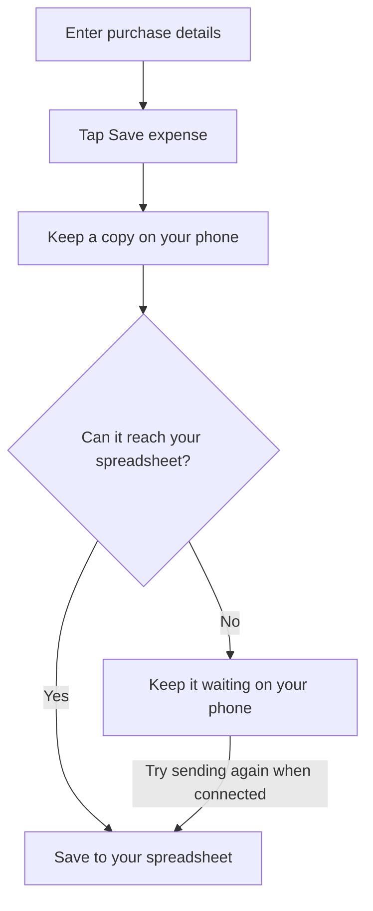
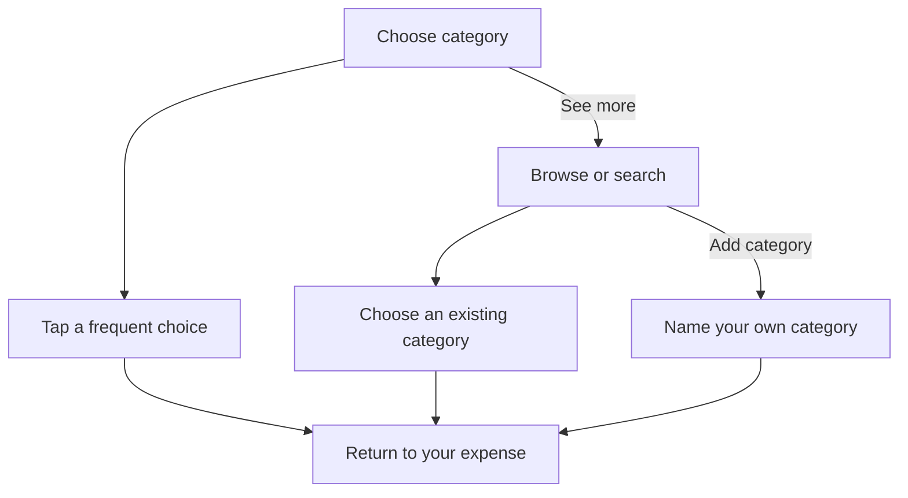
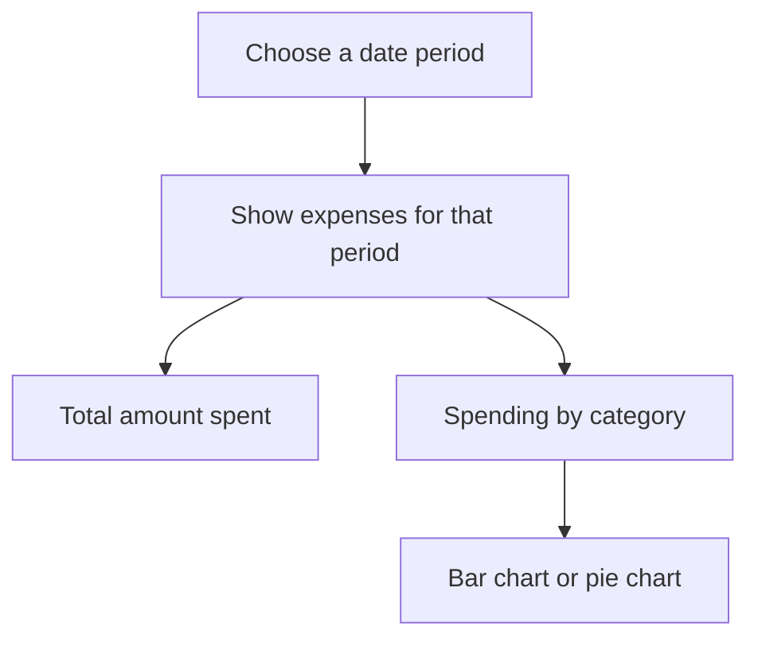
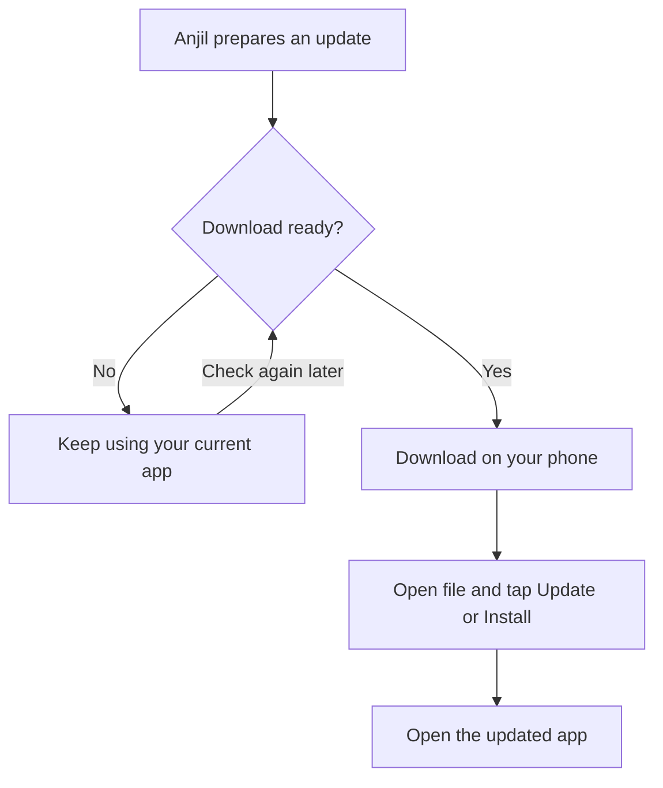
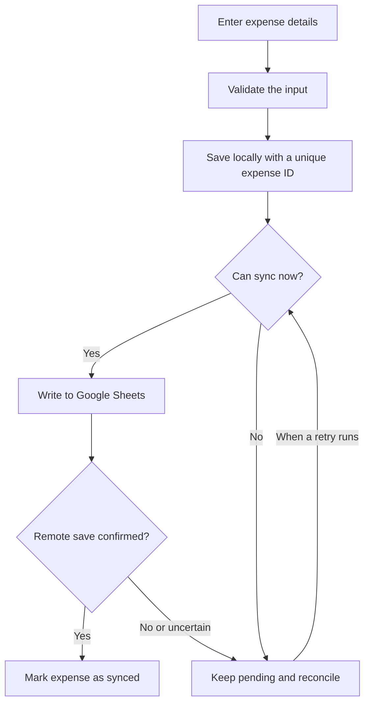
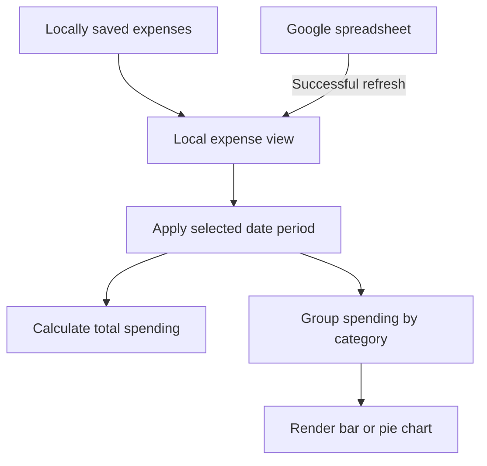
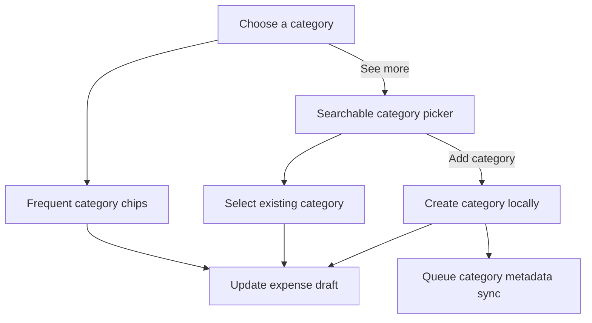
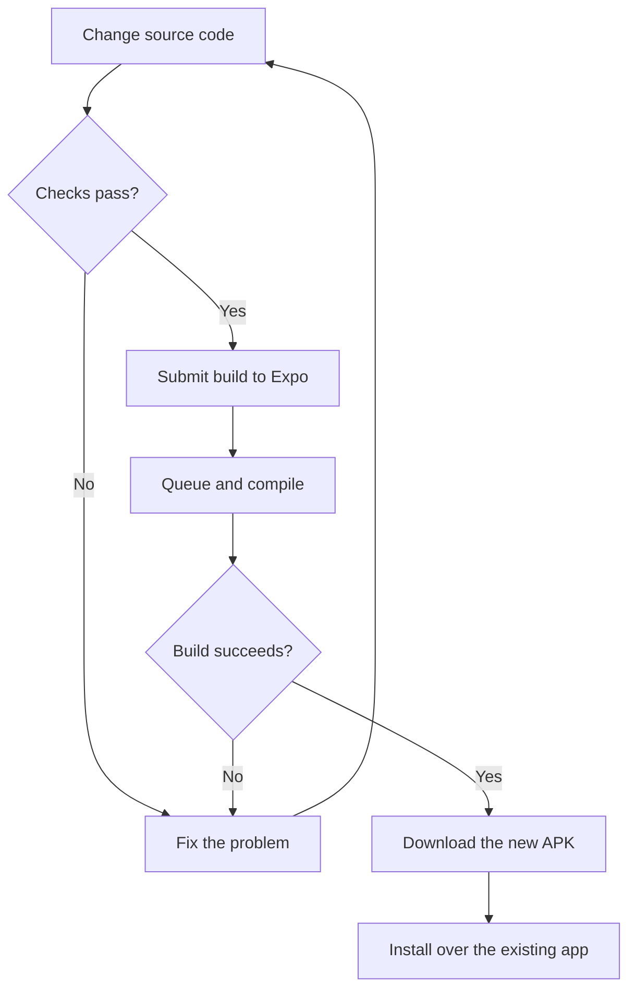

# Expense Tracker — Family Guide

## What is this app?

This app helps you record what you spend and see where your money goes.

You can:
- Add a purchase.
- Choose a category.
- View spending for a day, month, year or all time.
- See your spending in bar or pie charts.
- Add your own categories after installing the category update.

Your phone keeps a copy of your expenses. When connected, the app also
saves them to your Google spreadsheet.

You do not need a computer to use the app.

Ask Anjil to arrange your account and spreadsheet before your first use.
The app does not automatically combine everyone's spending into a family
total.

## 1. Add an expense

1. Open Add expense.
2. Enter the amount.
3. Write a short description.
4. Choose a category.
5. Check the date.
6. Tap Save expense.

Example:

| Field | Example |
| --- | --- |
| Amount | $7.60 |
| Description | Milk and bread |
| Category | Groceries |
| Date | The day you bought it |

The app currently uses Australian dollars.



Read the message after saving:

- Saved to Google Sheets: the online save is confirmed.
- Pending or waiting to send: it is on your phone but still needs
  to reach your spreadsheet.
- Error: something needs attention.

If an expense is waiting, reconnect to the internet, reopen the app
and check its status. Use a retry option if one is shown.

If it stays pending, ask Anjil. Avoid entering the same purchase again.

## 2. Choose a category

The main screen shows a few frequently used categories.

For more choices:
1. Tap See more.
2. Search or scroll through the list.
3. Tap the category you want.



Some examples:

| Purchase | Possible category |
| --- | --- |
| Supermarket shopping | Groceries |
| Restaurant or takeaway | Eating out |
| Electricity bill | Utilities |
| Petrol | Fuel |
| Streaming service | Subscriptions |
| Pet food or vet visit | Pets |
| Something without a suitable category | Other |

### Add your own category

1. Tap See more.
2. Tap + Add category at the bottom.
3. Enter a short name, such as Garden.
4. Tap Create & select.

If that name already exists, choose the existing category.

Your new category is remembered for later use.

Adding a category does not save the purchase. Finish the expense
details and tap Save expense afterward.

If See more or + Add category is missing, ask Anjil whether the
category update is ready and installed.

## 3. See your spending

1. Open My spending.
2. Choose Day, Month, Year or All time.
3. Select the period you want.
4. View the total and choose Bar or Pie.



The total tells you how much you spent.

A bar chart helps compare categories.
A pie chart shows each category's share of the total.

For example:

- Groceries: $30
- Eating out: $10
- Total: $40

Groceries would be 75% of the total, and eating out would be 25%.

Changing the date period changes which expenses are included.

### What does Refresh do?

Refresh checks your Google spreadsheet for updated expense information.

Use it after changing an expense directly in the spreadsheet.

When offline, the app may show the last information stored on your phone.

## 4. Update the app

Anjil will provide a new download when an update is ready.

The Android installation file may be called an APK.



Install the update over the existing app.

Do not delete the old app first.

If the phone refuses to install the update, send Anjil the exact
message and ask for help.

## 5. Save, Refresh and Update mean different things

| Action | What it does |
| --- | --- |
| Save expense | Records a purchase |
| Refresh | Checks the spreadsheet for updated expense information |
| Install an update | Adds changes to the app itself |

Refresh does not install new features.

## 6. If something looks wrong

| Problem | What to do |
| --- | --- |
| Expense is waiting to send | Reconnect, reopen the app and check its status |
| Expense is missing from a chart | Check the selected date period |
| Spreadsheet changes are missing | Refresh while connected |
| Saving shows an error | Keep the details and note the message |
| Google connection is blocked | Ask Anjil to help |
| New category options are missing | Ask whether the latest update is installed |

Keep the app installed while anything is waiting to send.

Expenses and categories that have not reached Google may exist
only on that phone.


----------------------------------------------

# Expense Tracker — Technical Guide

## Summary

Expense Tracker is a private Android app for recording expenses and
viewing spending by day, month, year or all time.

The app uses:
- React Native and Expo for the mobile interface.
- TypeScript for application logic.
- SQLite on the phone for local data and pending submissions.
- Google Sheets for the synced expense record.
- Local calculations and native charts for spending analysis.
- EAS Build to produce a privately installable Android APK.

A computer is used for development and builds. It is not required
for everyday use.

This guide describes the agreed architecture and the build information
shown during development. It is not an independent source-code audit.

## Current scope

- Android only.
- Expenses only.
- AUD amounts.
- Google spreadsheet connection.
- Offline storage and pending expense submissions.
- Day, month, year and all-time spending views.
- Bar and pie charts.
- Frequent categories, a full category picker and custom categories
  in the category enhancement.

General multi-user onboarding, account switching, combined family
results and iPhone support remain future work.

## 1. Components

| Component | Responsibility |
| --- | --- |
| React Native + Expo | Mobile screens and interactions |
| TypeScript | Application logic and types |
| expo-sqlite | Persistent local expense data and pending submissions |
| Google authentication | Permission to access the user's spreadsheet |
| Google Sheets API | Read and write expenses and category definitions |
| Local queries | Filter periods and calculate totals |
| React Native Gifted Charts | Chart library selected in the design; verify the actual dependency in package.json |
| EAS Build | Compile and sign the Android APK |

SQLite runs inside the Android app. It does not require a database
server on the computer.

Google Sheets contains the synced ledger. Until synchronization succeeds,
a pending expense may exist only on the phone.

## 2. Saving an expense



### Required behaviour

1. Validate the amount, description, category and date.
2. Persist the expense locally before reporting a successful local save.
3. Give the expense a stable unique ID.
4. Attempt to send it to Google Sheets.
5. Mark it synced only after remote confirmation.
6. Preserve pending expenses when synchronization fails.

Use integer minor units for money:

- AUD 7.60 → 760 cents.
- Sum integer amounts.
- Format the result as currency for display.

Treat the expense date as a calendar date. Avoid moving a selected
purchase date to another day through timezone conversion.

### Duplicate prevention

The same expense must not be counted twice when it exists both in the
pending queue and the confirmed cache.

Google Sheets append does not provide an idempotency-key parameter.
A request can time out after Google has already accepted the write.

A unique expense ID supports reconciliation, but does not by itself
guarantee exactly-once delivery. Check for an existing ID before retrying
an uncertain append and prevent simultaneous submissions of the same item.

### Save status

Keep these meanings separate:

| Status | Meaning |
| --- | --- |
| Saved locally / pending | Stored on the phone but not confirmed in Google |
| Saved to Google Sheets | Remote save confirmed |
| Last refreshed | Last successful full read from Google Sheets |
| Error | An operation failed and may need retry or attention |

Do not assume synchronization continues while Android has closed the
app. Verify the actual retry triggers in the implementation.

## 3. Spending analysis and charts



The app calculates the data; the chart library draws it.

For the selected period:

1. Filter expenses by their expense date.
2. Sum the amounts in cents.
3. Group those amounts by category.
4. Calculate each category's percentage of the total.
5. Pass the results to the chart components.

Example:

- Groceries: $30
- Eating out: $10
- Total: $40
- Groceries: 75%
- Eating out: 25%

Python and Seaborn are not required for this mobile chart flow.

### Refresh behaviour

A successful refresh should:

- Read and validate the current Google Sheets ledger.
- Reflect spreadsheet edits and deletions.
- Update the confirmed local cache atomically.
- Preserve pending local expenses.
- Reconcile records by expense ID.
- Update the last-full-refresh timestamp.

A failed refresh should retain the previous valid cached data and
show the failure or stale state.

### Chart behaviour

- Keep category colours stable.
- Show readable names and exact amounts.
- Handle empty data and a single category.
- Use a meaningful common scale for bars.
- Calculate pie percentages from the selected period's total.
- Preserve valid custom category names instead of collapsing them
  into Other.

## 4. Category selection



### Compact main screen

Show at most six frequent category chips.

Initial choices:

- Groceries
- Eating out
- Transport
- Bills
- Shopping
- Health

Use distinct expense counts from the last 90 days to identify frequent
categories. Include locally saved pending expenses once.

Keep the order stable while the user is entering an expense.

Normally keep the chips within two rows. On narrow screens or with
large text, show fewer chips rather than clipping labels or shrinking
touch targets.

If a category selected through See more is not visible, replace one
quick-access chip with it instead of adding another row.

### Full picker

See more opens a searchable, scrollable bottom sheet.

- Normally around 65–70% of screen height.
- Search at the top.
- Built-in and custom categories in the list.
- A selected indicator on the current category.
- Other at the end.
- An accessible + Add category action at the bottom.
- Selecting a category closes the picker.
- Dismissal and Android Back preserve the expense draft.

### Built-in categories

Existing categories remain unchanged:

- Groceries
- Eating out
- Transport
- Bills
- Shopping
- Health
- Other

Additional categories:

- Rent & mortgage
- Utilities
- Phone & internet
- Insurance
- Home & maintenance
- Fuel
- Vehicle maintenance
- Entertainment
- Subscriptions
- Travel & holidays
- Personal care
- Fitness & sport
- Education
- Children & family
- Pets
- Gifts & donations
- Fees & interest
- Taxes
- Work expenses

Do not automatically relabel historical expenses.

### Custom categories

Required behaviour:

- Require a name of 1–30 characters after trimming.
- Reject duplicate names after case and whitespace normalization.
- Assign a stable ID, icon and chart colour.
- Persist immediately in SQLite, including offline.
- Synchronize definitions to a separate Categories tab within the
  existing Google spreadsheet.
- Preserve unsynced categories during refresh.
- Restore synced definitions after reconnecting or reinstalling.
- Write names as literal spreadsheet text.
- Preserve category labels discovered in existing expense rows.

Use one shared registry for category selection, validation, saving,
reading and chart presentation.

Creating a category selects it for the draft. It does not save an expense.

Renaming, deleting, merging and custom icon editors are outside the
requested category enhancement.

## 5. Building and updating the app



### Project identity

| Setting | Value |
| --- | --- |
| Expo project | @anjil07/expense-tracker |
| Android application ID | dev.expenses.tracker |
| Existing build profile | production |
| Existing distribution | internal |
| Expo SDK shown in build output | 58.0.0 |

### Useful commands

Run from the actual app project folder on the Mac: personal_finanace.

Confirm the connected project:

```bash
npx eas-cli@latest project:info
```

List recent builds:

```bash
npx eas-cli@latest build:list --platform android --limit 5
```

Check only the latest build:

```bash
npx eas-cli@latest build:list --platform android --limit 1
```

For a future release, start a build once after completing the changes
and checks:

```bash
npx eas-cli@latest build --platform android --profile production
```

Do not repeatedly start builds while one is already queued.

### Release requirements

- Keep the existing Android application ID.
- Reuse the existing signing key.
- Increase versionCode.
- Keep the profile configured to produce an APK.
- Verify the artifact before distributing it.

The profile name production does not itself guarantee APK output.
The existing internal distribution configuration previously produced APKs.

### Build status

| Output | Meaning |
| --- | --- |
| in queue | Waiting to start |
| in progress | Build running |
| finished with an APK URL | Ready to download |
| errored or canceled | Inspect the build details |
| Application Archive URL is null while queued | No APK exists yet |

The category release is version code 4. It was still queued in the
latest supplied screenshot. This is a historical observation, not a
live status check.

### Installing an update

Download the new APK on the phone and install it over the existing app.

Do not uninstall first or clear app storage. Pending expenses and
unsynced custom categories may exist only on that device.

If installation fails, inspect the exact error, package identity,
signing key and version before trying a destructive workaround.

## 6. Refresh, CI/CD and automatic updates

| Operation | Purpose |
| --- | --- |
| Save / sync | Send expense or category data to Google Sheets |
| Refresh | Read current spreadsheet data into the app |
| Build APK | Package a new version of the app |
| Install APK | Update the app on the phone |
| CI | Automatically run checks after a configured trigger |
| CD | Automatically deliver releases after a configured trigger |
| EAS Update | Deliver compatible JavaScript and assets when configured |

The evidence shows manually triggered EAS builds. An automated CI/CD
pipeline has not been verified.

EAS Update configuration has not been inspected. Editing code or
building an APK does not automatically update the installed app.

Native runtime changes still require a compatible new binary.

## 7. Device checks before calling a release ready

1. Install over the previous version and confirm existing data remains.
2. Save an expense and verify the spreadsheet entry.
3. Save offline, reconnect and confirm one remote record.
4. Refresh after a spreadsheet edit and verify the dashboard.
5. Search and select a category outside the frequent chips.
6. Create a custom category, restart and confirm persistence.
7. Confirm category metadata sync and correct chart labels.
8. Check the keyboard, Android Back, large text and both themes.

Claude reported automated checks passing for the category change.
That does not replace testing the installed APK on Android.

Use a separate test setup for uninstall/reinstall recovery tests.

## References

- Expo SQLite:
  https://docs.expo.dev/versions/latest/sdk/sqlite/
- Google Sheets append API:
  https://developers.google.com/workspace/sheets/api/reference/rest/v4/spreadsheets.values/append
- EAS CLI:
  https://docs.expo.dev/eas/cli/
- Android APK builds:
  https://docs.expo.dev/build-reference/apk/
- EAS Update:
  https://docs.expo.dev/eas-update/introduction/